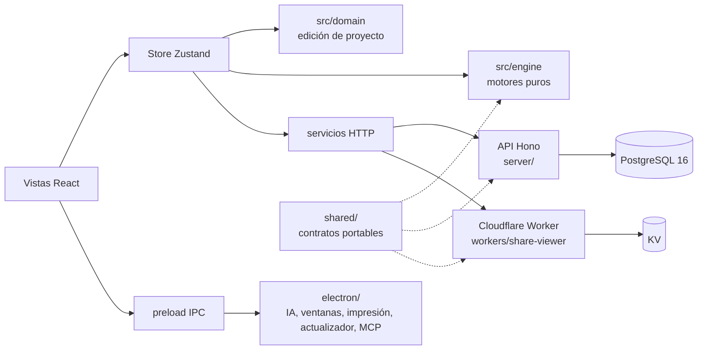

# SolarSim Pro

[](https://github.com/WilkerDev1/solarsim-pro/actions/workflows/verify.yml)
[](https://github.com/WilkerDev1/solarsim-pro/releases/latest)

Simulador técnico-económico de escritorio para diseñar y cotizar sistemas fotovoltaicos con almacenamiento (BESS) en República Dominicana. Lo usan ingenieros y consultores de Electsun para llevar un proyecto desde la factura del cliente hasta una propuesta PDF o web lista para enviar.

## Qué hace

- **Energía:** producción por provincia (HSP), pérdidas, degradación, balance con medición neta o antivertido, autoconsumo y banco de baterías (energía útil y autonomía).
- **Tarifas:** distribuidoras y tarifas dominicanas (BTS, BTD, MTD), retención de exportación SIE y tasa de cambio.
- **Finanzas:** matriz de costos o precio por Wp, margen, ITBIS, crédito de la Ley 57-07, VAN, TIR, payback y flujo a 25 años.
- **Propuestas:** documento PDF editable en la hoja, propuesta web publicada con enlace y QR, y fichas técnicas anexadas automáticamente.
- **Catálogo:** paneles, inversores y baterías con precios por proveedor, compartido por organización.
- **Trabajo en equipo:** organizaciones con roles ADMIN, EDITOR y LECTOR, sincronización con control de versiones e historial. Sin conexión el trabajo se guarda en el equipo y se sincroniza después.
- **Asistente IA:** lectura de facturas, fichas técnicas y listas de precios, y borradores de propuesta con Google Gemini (clave del usuario). Ningún borrador se aplica sin revisión.

## Descarga

Los instaladores están en [Releases](https://github.com/WilkerDev1/solarsim-pro/releases/latest):

| Plataforma | Formatos |
|---|---|
| Windows x64 | instalador (`Setup`) y portable |
| Linux x64 | AppImage, `.deb`, `.pacman` y `.tar.gz` |

Los paquetes Linux y los manifiestos de actualización se firman con la clave GPG de SolarSim (`solarsim-public-key.asc` en cada release); la aplicación verifica la firma antes de instalar una actualización. Windows no tiene firma Authenticode. macOS y ARM no se publican. Detalles en [docs/MAINTENANCE_AND_UPDATES.md](docs/MAINTENANCE_AND_UPDATES.md).

## Arquitectura



| Carpeta | Contenido |
|---|---|
| `src/` | Aplicación React 18 + TypeScript + Zustand + Tailwind: vistas, store, motores de cálculo (`engine/`) y reglas de edición (`domain/`). |
| `electron/` | Proceso principal de Electron 44: llamadas a IA, ventanas, impresión, actualizador firmado y servidor MCP local. |
| `shared/` | TypeScript puro que comparten la aplicación, la API y el Worker: equipos (`equipment/`), supuestos (`assumptions.ts`), reglas fiscales, permisos y textos del documento. |
| `server/` | API de sincronización con Hono y PostgreSQL 16 en Docker: JWT, organizaciones y roles, control de versiones (CAS), migraciones y versión mínima de cliente. |
| `workers/share-viewer/` | Cloudflare Worker que publica copias inmutables de las propuestas web. |
| `docs/` | Especificaciones, procedimientos y decisiones de arquitectura (`docs/adr/`). |
| `scripts/` | Pruebas, releases y QA (ensayo de restauración, compatibilidad de despliegue). |

Más detalle en [docs/ARCHITECTURE.md](docs/ARCHITECTURE.md).

## Desarrollo

Requisitos: Node.js 24 o superior y npm. Docker solo para las pruebas de integración de la API.

```bash
npm ci
npm run dev               # aplicación web en Vite
npm run electron:dev      # aplicación de escritorio en desarrollo
npm run lint              # verificación de tipos
npm test                  # suites del cliente (una suite: npm test -- <filtro>)
npm run build && npm run build:electron
npm --prefix server ci && npm --prefix server test
npm --prefix workers/share-viewer ci && npm --prefix workers/share-viewer test
```

Las pruebas del cliente no pueden llamar a la red: inyectan un transporte sintético, y ninguna escribe en servidores de producción.

### Flujo de trabajo

- `beta` es la rama de desarrollo y `main` solo recibe releases aprobadas.
- Cada cambio entra por pull request a `beta`, con mensajes [Conventional Commits](https://www.conventionalcommits.org/es/) en español.
- Antes de fusionar: CI en verde y revisión sin hallazgos.
- Las releases suben a la vez la versión de la aplicación, la API y el Worker (`npm run release:bump -- X.Y.Z`); el tag `vX.Y.Z` en `main` genera los instaladores en GitHub Actions.
- [AGENTS.md](AGENTS.md) reúne los contratos, invariantes y comprobaciones obligatorias para contribuir.

## Documentación

- [Índice de la documentación](docs/README.md)
- [Glosario](GLOSSARY.md)
- Decisiones de arquitectura:
  - [0001: equipos sin espejo](docs/adr/0001-equipment-model-sin-espejo.md)
  - [0002: banco de baterías](docs/adr/0002-banco-de-baterias.md)
  - [0003: supuestos resueltos](docs/adr/0003-supuestos-resueltos.md)
  - [0004: edición de proyecto](docs/adr/0004-edicion-de-proyecto.md)
- [Mantenimiento y releases](docs/MAINTENANCE_AND_UPDATES.md)
- [Infraestructura y despliegue](docs/INFRASTRUCTURE_ARCHITECTURE.md)

## Licencia

Desarrollado por WilkerDev1. Todos los derechos reservados.
