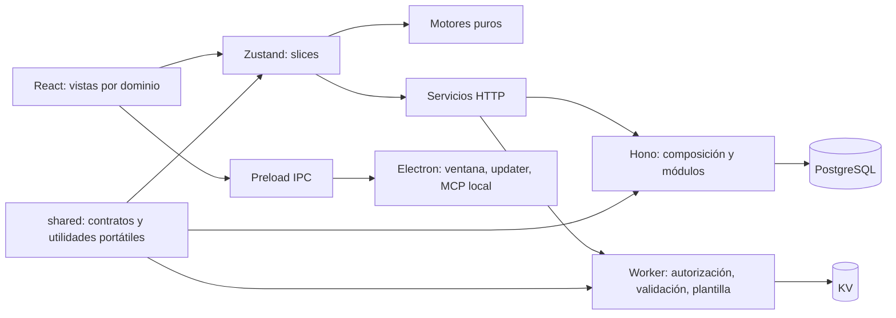

# Monolito modular

SolarSim conserva React, Zustand, Electron y Hono/PostgreSQL. El producto de escritorio agrupa dominios; la API y el visor Cloudflare tienen procesos y ciclos de despliegue propios. No se introducen microservicios por dominio.



## Dependencias permitidas

- `shared/`: contratos y normalizadores TypeScript puros, sin React, Electron ni base de datos. Tres módulos concentran reglas que todos los consumidores comparten: `shared/equipment/` (EquipmentModel: lee, edita, totaliza, describe y migra los grupos de equipos; no hay espejo heredado, [ADR 0001](adr/0001-equipment-model-sin-espejo.md); `battery.ts` calcula la energía útil y la autonomía del banco, [ADR 0002](adr/0002-banco-de-baterias.md)), `shared/assumptions.ts` (tabla de rangos y valores por defecto de los supuestos y su resolución, [ADR 0003](adr/0003-supuestos-resueltos.md)) y `shared/clientVersion.ts` (comparación semver de la versión mínima de cliente). Sin excepciones: desde F6 no queda I/O HTTP dentro de `shared/` (el transporte REST de Gemini, `geminiTransport.ts`, se retiró; las llamadas a Gemini viven en el puerto `LlmClient` del renderer).
- `src/engine/`: cálculos puros con argumentos explícitos. No importa el store ni decide permisos. Lee supuestos de `resolveAssumptions` y el banco de `batteryBank`; no repite literales ni la fórmula de energía útil.
- `src/domain/`: reglas de dominio puras sobre una propuesta. `projectEdit.ts` (`applyProjectEdit`, `applyProjectEditPlan`, `applyDocumentClientEdit`) es el único lugar que decide el resultado de una edición de specs, tarifas, cliente, consumo, finanzas o precio de proveedor ([ADR 0004](adr/0004-edicion-de-proyecto.md)). `projectFields.ts` es el registro de campos editables (ruta, etiqueta, tipo, rango, dependencias, ancla del dock) y `projectEditTransaction.ts` (`applyProjectEdits`) aplica un lote de ediciones por ruta, todo o nada e independiente del orden, y devuelve el diff y los resultados del motor; el store lo escribe con `commitProjectEdits` (una escritura, un autosync, un paso de deshacer), que es por donde escribe el dock ([ADR 0004, transacción](adr/0004-edicion-de-proyecto.md#registro-de-campos-y-transacción-f2a2)). Sin Zustand, temporizadores ni reloj.
- `src/features/application/`: selección del modo efectivo; adapta política del store al motor.
- `src/services/`: transporte, validación de respuestas y publicación. Sin componentes de UI. `src/services/llm/` es el puerto `LlmClient` y el único sitio que importa el SDK `@google/genai` ([ADR 0008](adr/0008-puerto-llm-y-sdk-google-genai.md)); `electron/` no lo alcanza. Sobre el puerto viven la política de salida estructurada de los escáneres (`structuredPolicy.ts`: modelo de reserva, truncado, JSON inválido, plazo, cancelación) y la carga bajo demanda del adaptador (`scannerClient.ts`).
- `src/store/slices/`: estado y operaciones del dominio. La composición raíz conserva todos sus exports públicos. Las porciones de proyecto llaman a `applyProjectEdit` dentro de `updateActiveProject` y solo añaden sello de mutación, sincronización y deshacer; mirar una propuesta nunca escribe (ningún `useEffect` del simulador llama a un escritor del proyecto).
- `src/store/sync/`: reconciliación pura, pertenencia, mutaciones y comandos de eliminación. No confunde versión local con versión confirmada.
- `src/store/undo/`: diario de deshacer por propuesta, puro y solo en memoria; Ctrl+Z nunca cruza propuestas ([ADR 0004](adr/0004-edicion-de-proyecto.md#deshacer-por-propuesta-f2a1)).
- `src/store/persistence/`: serialización durable y migración/rehidratación. Solicitudes, flags de carga y generación de sesión son transitorios. Las escrituras se agrupan (`deferredStorage.ts`, 400 ms) y se omiten si ninguna porción persistida cambió de referencia; los logos y miniaturas del documento se guardan una sola vez en la clave `<nombre>-assets` como `asset:sha256:` y se expanden al hidratar (`persistedDocumentAssets.ts`), así que el store sigue viendo el base64. El espacio activo no se archiva en `organizationWorkspaces` (solo los de otras organizaciones).
- `src/components/`: presentación y eventos. Las vistas grandes se cargan bajo demanda en App; las decisiones matemáticas pertenecen al motor.
- `electron/`: única frontera con módulos nativos y ejecución del SO, expuesta por el preload aislado.
- `server/src/index.ts`: arranque. `app.ts`: composición inyectable (incluye la puerta de versión mínima de cliente, `clientVersionGate.ts`: 426 ante `X-SolarSim-Client` ausente u obsoleto). `modules/`: auth, usuarios, organización, proyectos, equipos, tarifas y notificaciones. `database/`: migraciones aditivas y acceso común.
- `workers/share-viewer/`: validación, autorización de publicación, repositorio KV, escaping y presentación separados.
- `mcp-remote/`: servidor MCP remoto sin estado; solo habla con la API por HTTP con el token del agente y reutiliza `shared/agentTools` ([MCP_REMOTE.md](MCP_REMOTE.md)).

- PDF: `src/utils/pdfLayout.ts` decide orden de secciones, numeración e índice; `PDFPageShell` aporta marca de agua, cabecera y pie A4. El total de páginas de cada pie ("N de M") incluye los anexos listados en el índice.

## Extensión

Un nuevo supuesto del proyecto se declara en `ASSUMPTION_RULES` (default, máximo, si el 0 cuenta como falta, si es entero) y se lee con `resolveAssumptions`; los valores de un proyecto nuevo salen de `assumptionFields`. Una regla nueva de edición se escribe una vez en `src/domain/projectEdit.ts`. Pruebas de guarda impiden copias de estas reglas fuera de sus módulos (ver [QA.md](QA.md)).

Una nueva función se registra en `shared/applicationFeatures.ts`, define su default/etapa/visibilidad/disponibilidad y usa el selector efectivo. Cambiar solo una etiqueta de UI nunca cambia el modelo de cálculo. Una nueva ruta registra su módulo desde app y usa la autorización actual en BD. Las migraciones se numeran y no se ejecutan desde el renderizador.

El perfil empresarial de la organización sincroniza el membrete principal; los membretes locales adicionales personalizan documentos. Las organizaciones autenticadas delimitan autorización y sincronización. Carpetas, registro de propuestas web y adjuntos del catálogo siguen el contrato de [recursos compartidos](SHARED_RESOURCES.md). Son conceptos distintos. No se adjudican automáticamente propuestas locales o de otra organización al iniciar sesión: para mover contenido se exporta/importa una copia de forma explícita.

## Subsistema IA

`shared/aiProposal.ts` concentra el esquema y la normalización multi-equipo del borrador de propuesta; `src/domain/proposalDraft.ts` (`buildProjectFromDraft`, puro) lo convierte en propuesta con las reglas de una edición. Lo usa `create_proposal` de las herramientas compartidas; el asistente de la app crea con la fábrica única. Desde F6 no hay pantalla de revisión del borrador: el modal «Asistente de propuestas» se retiró ([ADR 0013](adr/0013-eliminacion-del-camino-antiguo.md)). Los importadores de datasheets/precios preparan el lote y verifican permisos y resultado del store. La procedencia tarifaria acompaña filas y campos conservados. Véanse [escáneres IA](AI_SCANNERS_SPECIFICATION.md) y [tarifas IA](AI_TARIFF_CONTEXT.md).

`shared/aiProposalCommercial.ts` valida el contrato comercial; `src/utils/proposalDraftProject.ts` adapta el borrador normalizado a la propuesta. El consumo teórico usa factores sin redondear exportados por el motor solar, sin duplicar una fórmula asociada a documentos comerciales. Totales documentales son referencias informativas, nunca overrides del motor.

Todo Gemini sale del renderer: no hay llamadas de IA en el proceso principal ni canales IPC de IA (`electron/ai` se retiró en F6). El preload solo expone impresión a PDF, actualizaciones, enlaces externos y el puente del MCP local.

## Asistente general

Desde F4 ([ADR 0011](adr/0011-sesion-y-bucle-del-asistente.md)) el panel flotante (`components/AppAssistant.tsx`) solo pinta una sesión que vive fuera de React (`src/features/assistant/session/assistantSession.ts`: conversación, historial del modelo de turnos cerrados, adjuntos y turno en curso; sobrevive a cambiar de vista, de propuesta y a cerrar el panel, y se descarta al cambiar de espacio o de sesión). La sesión corre un bucle propio (`session/agentLoop.ts`) sobre el puerto `LlmClient` ([ADR 0008](adr/0008-puerto-llm-y-sdk-google-genai.md)) con el conjunto de herramientas de F3a (`listAssistantToolset`/`executeAssistantToolset`), las instrucciones en tres capas y los eventos del turno de F3c, y conecta los puertos de navegación y de lectura de facturas:

```
AppAssistant (React) ──subscribe──▶ assistantSession ──▶ runAgentLoop ──▶ LlmClient ──▶ geminiAdapter (@google/genai)
                                          │                    └──▶ executeAssistantToolset ──▶ commitProjectEdits / registro
                                          └──▶ puertos: openProposal (navega) · extractInvoice (LlmClient.structured)
```

Desde F5b ([ADR 0012](adr/0012-panel-completo-del-asistente.md)) es el panel completo y está encendido por defecto: un solo elemento en la fila raíz de `App.tsx` que en el simulador, el resumen y el PDF se acopla como columna derecha cuando al contenido le quedan 640 px (`panelLayout.ts`, puro) y flota en el resto, sin remontarse; su clave es solo el espacio y la sesión. La sesión encola lo que se escribe mientras trabaja y el bucle cede al terminar el paso; cada respuesta con cambios deja una `ChangeCard` (F5a), cada creación una tarjeta «Propuesta creada» y el turno ofrece «Deshacer todo el turno»; el estado de las tarjetas se deriva al pintar (`panelState.ts`, puro) con la actividad y la cola de confirmaciones del store. El menú de IA del dock, «Crear con el asistente» y «Autocompletar con factura» abren este panel (`assistantEntry.ts`); el modal del asistente de propuestas, `electron/ai` y el camino de ejecución antiguo se retiraron en F6 ([ADR 0013](adr/0013-eliminacion-del-camino-antiguo.md)). Lo que sigue describe las piezas comunes.

`src/features/assistant/` separa la sesión y el bucle (`session/`), el panel y la validación y etiquetas de las herramientas compartidas. Las herramientas solo actúan sobre el espacio actual según su tipo (consulta, borrador con deshacer o cambio con confirmación); no ejecutan funciones arbitrarias, código ni HTML. Cada aplicación revalida servidor/organización, sesión/rol y fingerprint. App monta el panel de forma diferida. Su activación es una preferencia local (`uiSlice.appAssistantEnabled`, encendida por defecto con una migración de una sola vez), no una función de `shared/applicationFeatures.ts` ni parte de la política de organización. Las herramientas viven en un registro común (`shared/agentTools/` y `src/features/agentTools/`) que comparten el asistente de la app y los agentes externos (MCP local y remoto). Ver [AGENT_TOOLS.md](AGENT_TOOLS.md).
