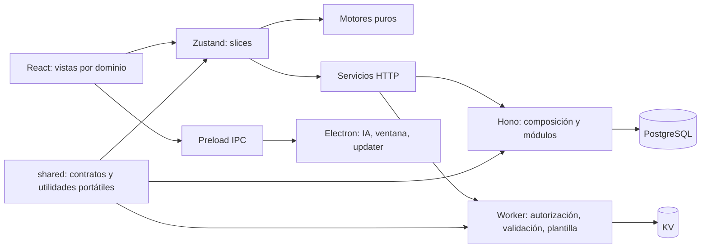

# Monolito modular

SolarSim conserva React, Zustand, Electron y Hono/PostgreSQL. El producto de escritorio agrupa dominios; la API y el visor Cloudflare tienen procesos y ciclos de despliegue propios. No se introducen microservicios por dominio.

## Dependencias permitidas

- `shared/`: contratos y normalizadores TypeScript puros, sin React, Electron ni base de datos. Tres módulos concentran reglas que todos los consumidores comparten: `shared/equipment/` (EquipmentModel: lee, edita, totaliza, describe y migra los grupos de equipos; no hay espejo heredado, [ADR 0001](adr/0001-equipment-model-sin-espejo.md); `battery.ts` calcula la energía útil y la autonomía del banco, [ADR 0002](adr/0002-banco-de-baterias.md)), `shared/assumptions.ts` (tabla de rangos y valores por defecto de los supuestos y su resolución, [ADR 0003](adr/0003-supuestos-resueltos.md)) y `shared/clientVersion.ts` (comparación semver de la versión mínima de cliente). Excepción explícita: `geminiTransport.ts` realiza I/O HTTP portátil mediante Fetch/AbortController y transporte inyectable; no importa módulos Node ni decide permisos o estado de UI. La política de cancelación, timeout y reintentos se comparte entre navegador y Electron.
- `src/engine/`: cálculos puros con argumentos explícitos. No importa el store ni decide permisos. Lee supuestos de `resolveAssumptions` y el banco de `batteryBank`; no repite literales ni la fórmula de energía útil.
- `src/domain/`: reglas de dominio puras sobre una propuesta. `projectEdit.ts` (`applyProjectEdit`, `applyDocumentClientEdit`) es el único lugar que decide el resultado de una edición de specs, tarifas, cliente, consumo, finanzas o precio de proveedor ([ADR 0004](adr/0004-edicion-de-proyecto.md)). Sin Zustand, temporizadores ni reloj.
- `src/features/application/`: selección del modo efectivo; adapta política del store al motor.
- `src/services/`: transporte, validación de respuestas y publicación. Sin componentes de UI.
- `src/store/slices/`: estado y operaciones del dominio. La composición raíz conserva todos sus exports públicos. Las porciones de proyecto llaman a `applyProjectEdit` dentro de `updateActiveProject` y solo añaden sello de mutación, sincronización y deshacer; mirar una propuesta nunca escribe (ningún `useEffect` del simulador llama a un escritor del proyecto).
- `src/store/sync/`: reconciliación pura, pertenencia, mutaciones y comandos de eliminación. No confunde versión local con versión confirmada.
- `src/store/persistence/`: serialización durable y migración/rehidratación. Solicitudes, flags de carga y generación de sesión son transitorios.
- `src/components/`: presentación y eventos. Las vistas grandes se cargan bajo demanda en App; las decisiones matemáticas pertenecen al motor.
- `electron/`: única frontera con módulos nativos y ejecución del SO, expuesta por el preload aislado.
- `server/src/index.ts`: arranque. `app.ts`: composición inyectable (incluye la puerta de versión mínima de cliente, `clientVersionGate.ts`: 426 ante `X-SolarSim-Client` ausente u obsoleto). `modules/`: auth, usuarios, organización, proyectos, equipos, tarifas y notificaciones. `database/`: migraciones aditivas y acceso común.
- `workers/share-viewer/`: validación, autorización de publicación, repositorio KV, escaping y presentación separados.

- PDF: `src/utils/pdfLayout.ts` decide orden de secciones, numeración e índice; `PDFPageShell` aporta marca de agua, cabecera y pie A4. El total de páginas de cada pie ("N de M") incluye los anexos listados en el índice.

## Extensión

Un nuevo supuesto del proyecto se declara en `ASSUMPTION_RULES` (default, máximo, si el 0 cuenta como falta, si es entero) y se lee con `resolveAssumptions`; los valores de un proyecto nuevo salen de `assumptionFields`. Una regla nueva de edición se escribe una vez en `src/domain/projectEdit.ts`. Pruebas de guarda impiden copias de estas reglas fuera de sus módulos (ver [QA.md](QA.md)).

Una nueva función se registra en `shared/applicationFeatures.ts`, define su default/etapa/visibilidad/disponibilidad y usa el selector efectivo. Cambiar solo una etiqueta de UI nunca cambia el modelo de cálculo. Una nueva ruta registra su módulo desde app y usa la autorización actual en BD. Las migraciones se numeran y no se ejecutan desde el renderizador.

El perfil empresarial de la organización sincroniza el membrete principal; los membretes locales adicionales personalizan documentos. Las organizaciones autenticadas delimitan autorización y sincronización. Carpetas, registro de propuestas web y adjuntos del catálogo siguen el contrato de [recursos compartidos](SHARED_RESOURCES.md). Son conceptos distintos. No se adjudican automáticamente propuestas locales o de otra organización al iniciar sesión: para mover contenido se exporta/importa una copia de forma explícita.

## Subsistema IA

`shared/aiProposal.ts` concentra prompt, esquema y normalización multi-equipo. El hook de propuesta adapta catálogo, tarifas y contexto de cálculo del espacio actual; el borrador es transitorio y requiere revisión humana antes de aplicar. Los importadores de datasheets/precios preparan el lote y verifican permisos y resultado del store. La procedencia tarifaria acompaña filas y campos conservados. Véanse [escáneres IA](AI_SCANNERS_SPECIFICATION.md) y [tarifas IA](AI_TARIFF_CONTEXT.md).

`shared/aiProposalCommercial.ts` valida el contrato comercial; `src/utils/proposalDraftProject.ts` adapta el mismo borrador normalizado para cálculo previo y aplicación. El hook calcula energía y resumen financiero por separado para que un costo pendiente no invalide la vista energética. Las pestañas de consumo/dimensionamiento y cotización son componentes de presentación; no cambian los motores.

El contrato conversacional distingue respuesta informativa de borrador mutable. El consumo teórico usa factores sin redondear exportados por el motor solar, sin duplicar una fórmula asociada a documentos comerciales. Hook, normalización de transporte y store comparten esa referencia; el store sigue verificando antes de aplicar. Totales documentales son referencias informativas, nunca overrides del motor.

## Asistente general experimental

`src/features/assistant/` separa transporte conversacional, registro de herramientas, validación, hooks y tarjetas React. Las herramientas solo actúan sobre el espacio actual según su tipo (consulta, borrador con deshacer o cambio con confirmación); no ejecutan funciones arbitrarias, código ni HTML. Cada aplicación revalida servidor/organización, sesión/rol y fingerprint. App monta el panel de forma diferida; conversación/divisor se comparten con el borrador de propuestas. Su activación es una preferencia local (`uiSlice.appAssistantEnabled`, apagada por defecto), no una función de `shared/applicationFeatures.ts` ni parte de la política de organización. Las herramientas viven en un registro común (`shared/agentTools/` y `src/features/agentTools/`) que comparten el asistente de propuestas, el asistente general y el futuro MCP local. Ver [AGENT_TOOLS.md](AGENT_TOOLS.md).
